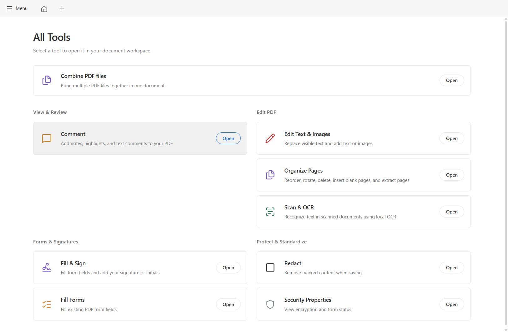
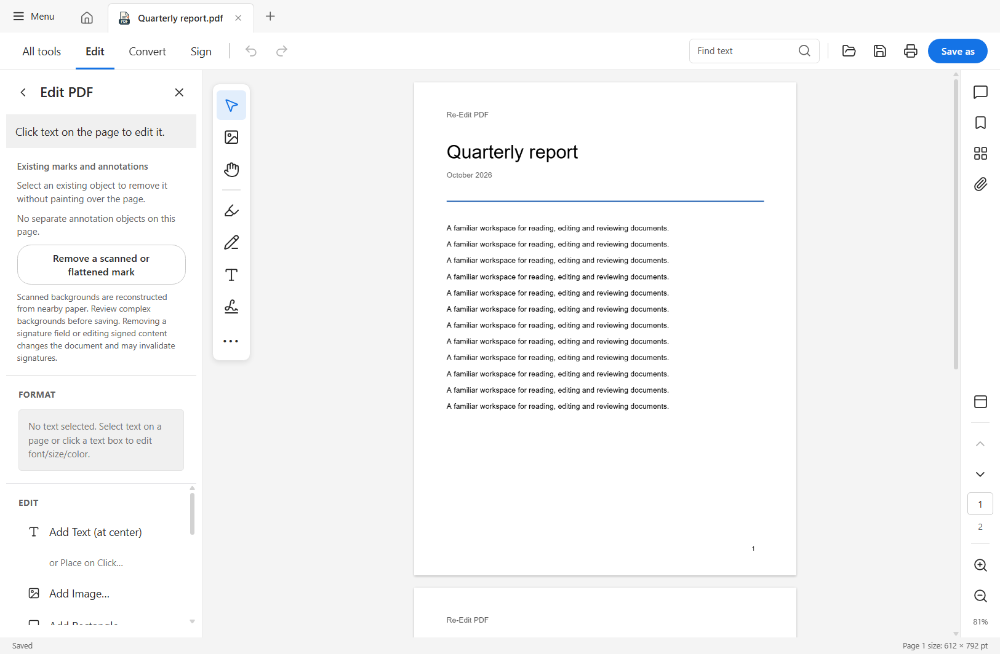
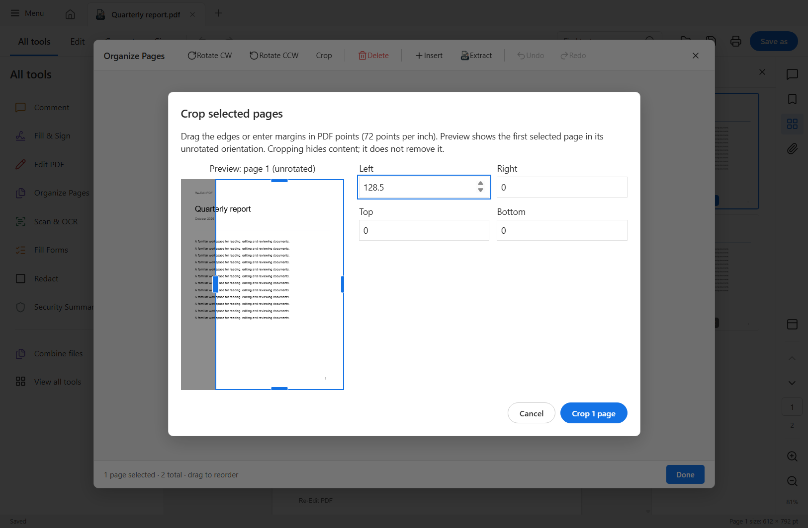

<p align="center">
  
</p>
<h1 align="center">Re-Edit PDF</h1>
<p align="center">Read, edit, annotate and recognize text in PDFs on Windows and Linux.</p>
<p align="center">
  <a href="https://github.com/Avaneesh-Inamdar/ReEdit-PDF-Reader-and-Editor/releases/latest"></a>
  <a href="https://github.com/Avaneesh-Inamdar/ReEdit-PDF-Reader-and-Editor/releases"></a>
  <a href="https://github.com/Avaneesh-Inamdar/ReEdit-PDF-Reader-and-Editor/actions/workflows/build-desktop.yml"></a>
  <a href="LICENSE"></a>
</p>

<p align="center">
  <a href="#download"></a>
  <a href="#features"></a>
  <a href="#getting-started"></a>
  <a href="#development"></a>
</p>


The tools center and editing workspace, shown with a sample document:







## Download

Download [Re-Edit PDF v2.1.0 prerelease](https://github.com/Avaneesh-Inamdar/ReEdit-PDF-Reader-and-Editor/releases/tag/v2.1.0) for Windows or Linux, or choose the [signed stable v2.0.0 release](https://github.com/Avaneesh-Inamdar/ReEdit-PDF-Reader-and-Editor/releases/latest). The native app uses a Rust desktop backend and the existing React workspace in the system webview, without the Electron runtime.

Version 2.1.0 is currently a **manual-download prerelease**. Its existing updater signing key was unavailable in the release audit environment, so it has no signed update manifest and is not offered through automatic updates. The signed stable feed remains on 2.0.0. Install 2.1.0 manually if you want to try its new editing and printing workflows. See the [current Acrobat Pro audit](docs/releases/v2.1.0/AUDIT.md) and [validation report](docs/releases/v2.1.0/VALIDATION.md).

The download badge counts release-asset downloads across all versions. Repeat downloads and supporting files count separately; it is not a count of unique users.

| Platform | Package | Installation |
| --- | --- | --- |
| Windows x64 | Setup EXE | Run the installer; Finish can launch the app. |
| Windows x64 | MSI / portable ZIP | Install the MSI, or extract the ZIP and run its EXE with the included DLLs. Portable use requires WebView2. |
| Debian / Ubuntu x64 | DEB | `sudo apt install ./Re-Edit-PDF-*.deb` |
| Fedora / RPM x64 | RPM | `sudo dnf install ./Re-Edit-PDF-*.rpm` |
| Linux x64 | AppImage | Make executable, then run. Use `--appimage-extract-and-run` if FUSE is unavailable. |
| Linux x64 | Portable tar.gz | Extract and run `squashfs-root/AppRun`; a compatible glibc desktop is required. |

The setup EXE installs WebView2 when needed. Windows publisher signing is not configured; Windows may show a publisher warning. Updater signatures authenticate downloads; they are separate from Windows publisher signing.

The 2.1.0 prerelease contains the setup EXE, MSI, Windows ZIP, DEB, RPM, AppImage, Linux tar.gz, `SHA256SUMS`, and corresponding native MuPDF source archive. Checksums detect file changes; they are not publisher signatures. Build logs, screenshots and test reports stay in Actions or [release documentation](docs/releases/v2.1.0/VALIDATION.md).

Signed stable releases also contain `latest.json`. That manifest's `downloads` entries include hashes and version-bound signatures for their packages and MuPDF source archive. The app uses its configured public key to verify supported automatic updates. The 2.1.0 prerelease does not include this manifest.

Native builds check the [native update feed](updates/native-preview.json) without uploading PDF content. Its original filename is retained so alpha.2 installations can upgrade. Updates require confirmation before downloading and installing; unsaved documents must be resolved first. AppImage builds support in-app updating. DEB/RPM users should download and install the matching package through their package manager.

The **Publish native update feed** workflow refreshes that feed when an eligible native GitHub release is published or edited. It checks release versions and asset URLs, requires matching signature-version metadata, and keeps older release edits from replacing a newer feed. After stable promotion, experimental releases cannot replace the stable feed; they are excluded before fetching update metadata. The app verifies the downloaded package's cryptographic signature before installation.

Linux native packages require a glibc desktop environment and GTK/WebKitGTK support. Alpine/musl, ARM64 and macOS are not validated.

The installer registers PDF **Open With** support and a separate document icon. Choose Re-Edit PDF in Windows **Settings → Apps → Default apps**. Linux Preferences can set the PDF default through `xdg-mime`.

## Features

- **Document workspace:** tabs, thumbnails, bookmarks, attachments, page navigation, fit/zoom controls, light/dark themes and a compact tool layout.
- **Text editing:** select text and use Edit, Ctrl+E or the context menu. Supported embedded fonts retain size, color and transforms. Fragmented text is grouped into compatible lines. Editing a selected word keeps its connected line together so following words move with it; replacements can be edited again.
- **Fonts:** the native build includes 68 offline faces in seventeen families, including Adobe's Source Sans 3, Source Serif 4 and Source Code Pro. Full Source Sans/Serif fonts supplement the bundled subsets. Open-source alternatives include Arimo (Arial), Tinos (Times New Roman), Cousine (Courier New), Carlito (Calibri) and Caladea (Cambria). Installed TTF/OTF fonts and supported font imports are available. Unavailable or incomplete original fonts are matched to installed or bundled alternatives, with a substitution notice. Missing glyphs are checked before applying or saving edits.
- **Annotations:** highlight, underline, strikeout, text, shapes, drawing, images and signatures, with selection, removal and undo/redo. Existing annotation/field objects can be removed; a region eraser also handles flattened marks, with limited background reconstruction for scans.
- **OCR:** offline English recognition with accurate and fast models, automatic/column/block layouts, page ranges, searchable output and explicit save-copy/overwrite actions. Accurate automatic recognition uses adaptive thresholding and a second pass for sparse text.
- **Find:** result list, matching text excerpts, case/whole-word filters, F3 navigation and searchable edited/placed text.
- **Printing:** application print dialog with printer selection, copies, grayscale, duplex, ranges, odd/even pages, reverse order, paper size, scaling and preview.
- **Page tools:** combine, reorder, rotate, crop, number, extract and delete pages. In Organize Pages, Ctrl-click toggles individual pages, Shift-click selects a range, and page cards can be selected from the keyboard. Page labels can be headers or footers with left, center or right alignment; use `{page}` and `{total}` in the label. Numbering follows document position. Crop margins are measured in PDF points in the unrotated page orientation; cropping hides content without removing it. Restore full page resets the crop to the original media bounds.
- **Forms and security:** supported AcroForm fields, P12 certificate signing, genuine content redaction, password clearing and document permission details. Printing, copying, annotations, forms and assembly permissions are shown separately; this does not validate certificate trust.
- **Conversion:** editable Word text export and Office-to-PDF import through an optional LibreOffice installation.
- **Desktop integration:** native window controls, recent-file favorites/removal, file associations and Help → Check for Updates.

This project is independent of Adobe. It does not claim complete Acrobat Premium compatibility.

The [Acrobat workflow comparison](docs/ACROBAT-PARITY.md) records the remaining
feature gaps, the official-package evidence and checks. Version 2.1.0 adds
conservative paragraph wrapping, Size/Multiple/Poster/Booklet print layouts and
improved menu, pane and page keyboard navigation. It is not a complete Acrobat
replacement; the comparison explains the limits of each workflow.

The navigation pane supports keyboard access to bookmarks and its controls. Bookmarks are cleared when switching documents so that an unavailable outline does not show the previous document’s entries.

## Getting started

### Changes in 2.1.0

- Compatible horizontal paragraphs wrap within their text box. Moving or resizing
  a box in the inline editor keeps its font size, and replacements remain editable
  after saving and reopening. Complex mixed-format layouts retain line editing.
- Print Size, Multiple, Poster and Booklet layouts share their preview and output
  plan. Multiple supports four page orders and borders; Booklet supports left/right
  binding and front/back passes for manual duplex printing.
- Menus support F10 and arrow keys, F6 cycles visible panes, Ctrl+Shift+N focuses
  Go to Page, and document page/screen shortcuts respect focused controls. Space
  activates buttons, and internal links/bookmarks correctly resolve page zero.
- Package and regression validation is recorded in the
  [2.1.0 validation report](docs/releases/v2.1.0/VALIDATION.md).

### Changes in 2.0.0

- Ctrl+A selects PDF text, with the current page in single-page mode and every page in continuous mode. Copy includes pages outside the render window and uses edited text instead of removed originals.
- Find and inline text fields retain their own Select All behavior. Select All is also available in the Edit menu.
- Modal dialogs prevent background document shortcuts, and Escape, document changes and closing clear document selections.
- Drag selection releases pointer capture when its page is rebuilt or closed.
- Startup close works before renderer registration; unsaved changes still use the normal save/discard dialog.
- Stable update-feed publication rejects experimental releases after promotion.

### Native workspace improvements

- Stable Fit Width sizing for landscape certificates and mixed-size PDFs; scrolling no longer repeatedly changes zoom.
- Automatic font matching and connected-line editing, improved faint/sparse OCR text detection, and an opaque Convert menu.
- Existing annotation/signature-field removal, a region eraser for flattened marks, and clearer document permissions.
- Startup update notifications and a dedicated signed native-preview update feed.
- Tool and dialog buttons wrap long labels instead of spilling text outside their borders.

### Native desktop integration

- Native Open dialogs and the previous React workspace in a system webview.
- Inline text editing, corrected replacement spacing, additional open-source font alternatives, and centered save/discard/cancel dialogs.
- OCR text replacement reconstructs the surrounding paper to avoid white patches; saved replacements remain searchable and can be edited again.
- The Windows setup launches the app from Finish, registers a distinct PDF document icon, and appears in Windows Default Apps.
- Installer, WebView regression and Linux package checks are documented in the [validation report](docs/releases/v2.0.0-alpha.2/VALIDATION.md). Container/Xvfb checks do not replace stock desktop testing.
- Alpha.2 validation passed 142 local frontend tests, 27 native Rust tests, 76 Windows WebView checks, Windows installer lifecycle checks, and Debian/Ubuntu/Fedora package launches. Preview font and open/close cleanup checks passed in the measured scenarios.
- Version 2.0.0 package validation passed 88 Windows and 42 Linux app checks, 28 native tests per platform, two clean Windows installer runs, and Debian/Ubuntu/Fedora installed-package/AppImage launches. Details and measured memory limits are in the current validation report.

### Basic workflow

1. Open a PDF from Home, the file menu or the operating system.
2. Choose **Edit** to edit existing text, or select words and press **Ctrl+E**.
3. Use **All tools** for annotations, forms, OCR and document operations.
4. Save with **Ctrl+S**. OCR offers separate copy and overwrite buttons.
5. For additional fonts, choose an installed face or import a font in Format.

| Shortcut                       | Action                                 |
| ------------------------------ | -------------------------------------- |
| Ctrl+O / Ctrl+S / Ctrl+Shift+S | Open / Save / Save as                  |
| Ctrl+F / F3 / Shift+F3         | Find / Next match / Previous match     |
| Ctrl+E                         | Edit selected text                     |
| Ctrl+A / Ctrl+C                 | Select PDF text / Copy                 |
| Ctrl+Z / Ctrl+Y / Ctrl+Shift+Z | Undo / Redo                            |
| Ctrl+P                         | Print dialog                           |
| Ctrl+Tab / Ctrl+Shift+Tab      | Next / Previous document tab           |
| Ctrl+W / Ctrl+F4               | Close document                         |
| Alt+F4 / Ctrl+Q                | Close application                      |
| Ctrl+0 / Ctrl+1 / Ctrl+2       | Fit page / Actual size / Fit width     |
| Ctrl++ / Ctrl+-                | Zoom in / out                          |
| F4 / Shift+F4                  | Navigation / Tool pane                 |
| H / V / hold Space             | Hand / Text selection / Temporary hand |
| F11 / Ctrl+L                   | Full screen                            |

Precision-trackpad pinch uses PDF zoom; ordinary two-finger scrolling stays native. Hardware behavior depends on the OS and device driver.

## Development

Native development requires Rust, Node.js 22, a C/C++ toolchain and libclang,
plus the [Tauri prerequisites](https://v2.tauri.app/start/prerequisites/) for
your platform. LibreOffice is optional for Office import.

```sh
git clone https://github.com/Avaneesh-Inamdar/ReEdit-PDF-Reader-and-Editor.git
cd ReEdit-PDF-Reader-and-Editor
npm ci --ignore-scripts
npm run dev:desktop
```

The repository includes offline OCR models, PDF assets, fonts and license notices. `npm run setup:ocr` can restore OCR assets when needed.

### Checks

```sh
npm run typecheck:web
npx vitest run
npm run build:ui
cargo test --locked -p re-edit-pdf-desktop -p re-edit-pdf-native --no-default-features
```

The native WebView regression scripts use isolated profiles and generated PDFs.
Distribution and installer workflows run on disposable environments; they do
not install or uninstall the app on the development machine. The older
Electron regression scripts remain available for comparisons.

### Packaging

The **Build desktop packages** workflow builds native Windows EXE/MSI/portable
ZIP and Linux DEB/RPM/AppImage/tar.gz packages, stages the Windows C++ runtime,
and runs installer and desktop checks. **Validate Linux distributions** checks
the selected packages on Debian, Ubuntu and Fedora. Outputs are retained as
workflow artifacts; publication and signing are separate steps.

Build Linux packages on Linux. See [native development](src-tauri/README.md)
and [.github/workflows](.github/workflows) for prerequisites and commands.
The `package:win` and `build:linux` npm scripts still target the legacy
Electron reference; use the native workflow for native packages.

## Limitations

The [Tauri/Rust build](src-tauri/README.md) retains this app's React UI in the
system webview. Physical printer/trackpad, stock desktop/Wayland and broader
large-document checks remain outstanding. Native WOFF2 import is not supported
yet. [Release validation](docs/releases/v2.0.0/VALIDATION.md) and [migration history](native/LOCAL-VALIDATION.md) are
documented separately. Container/Xvfb results are not stock-desktop validation.

- Text editing currently reflows a compatible connected line, not arbitrary paragraphs across text boxes or pages.
- Scanned text has estimated typography. Replacing recognized text removes image pixels in the edited region; background reconstruction and automatic paragraph reflow are limited.
- OCR currently recognizes English. Accuracy depends on scan quality and layout; review the output.
- A subset font cannot supply omitted glyphs. Use a full installed/imported font when needed. Proprietary Adobe Fonts are not redistributed.
- Installed-font discovery covers supported TTF/OTF files. Font collections, advanced shaping and mixed-direction/vertical editing remain limited.
- Unsupported XFA forms and complex Office layout conversion do not have full parity.
- Printer hardware and driver behavior, physical trackpads, native Wayland/GPU sessions, FUSE mounting and physical certificate tokens need testing in their real environments.
- Memory checks describe measured scenarios and resource cleanup; they cannot establish that every document or driver is leak-free.

Report reproducible issues with the app version, OS, steps and a sample PDF you are permitted to share. Remove private information before attaching documents.

## License and acknowledgments

Created by **Avaneesh Inamdar**. Released under [AGPL-3.0-only](LICENSE).

The native preview uses Rust, Tauri, React, TypeScript, PDF.js, pdf-lib, MuPDF and Tesseract.js. The previous Electron app is retained as a development reference. Icons use Lucide; the application and PDF document marks are custom vectors.

See [THIRD-PARTY-NOTICES.md](THIRD-PARTY-NOTICES.md) for software, font and model notices. The preview release includes the application source tag, corresponding MuPDF source archive and checksums. [Build provenance and validation reports](docs/releases/v2.0.0-alpha.2/VALIDATION.md) are available in the repository.
