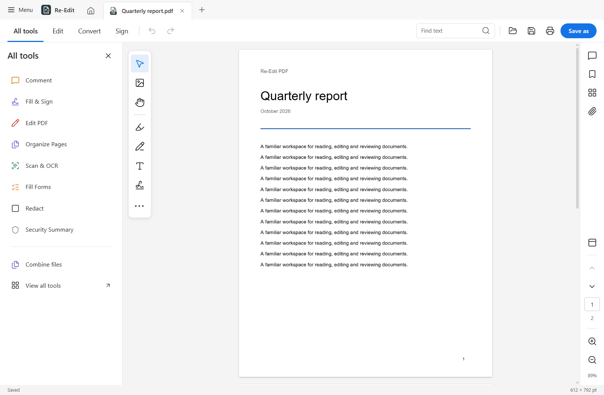

<p align="center">
  
</p>
<h1 align="center">Re-Edit PDF</h1>
<p align="center">Read, edit, annotate and recognize text in PDFs on Windows and Linux.</p>
<p align="center">
  <a href="https://github.com/Avaneesh-Inamdar/ReEdit-PDF-Reader-and-Editor/releases/latest"></a>
  <a href="https://github.com/Avaneesh-Inamdar/ReEdit-PDF-Reader-and-Editor/releases"></a>
  <a href="https://github.com/Avaneesh-Inamdar/ReEdit-PDF-Reader-and-Editor/actions/workflows/build-desktop.yml"></a>
  <a href="LICENSE"></a>
</p>

<p align="center">
  <a href="#download"></a>
  <a href="#features"></a>
  <a href="#getting-started"></a>
  <a href="#development"></a>
</p>



## Download

Download installers, portable builds, SHA-256 checksums and validation reports from [GitHub Releases](https://github.com/Avaneesh-Inamdar/ReEdit-PDF-Reader-and-Editor/releases/latest).

The download badge counts release-asset downloads across all versions. Repeat downloads and supporting files count separately; it is not a count of unique users.

| Platform            | Package      | Installation                                            |
| ------------------- | ------------ | ------------------------------------------------------- |
| Windows x64         | Setup EXE    | Run the installer; Finish can launch the app.           |
| Windows x64         | Portable EXE | Run directly without installing.                        |
| Debian / Ubuntu x64 | DEB          | `sudo apt install ./re-edit-pdf-*.deb`                  |
| Fedora / RPM x64    | RPM          | `sudo dnf install ./re-edit-pdf-*.rpm`                  |
| Linux x64           | AppImage     | Make executable, then run. Requires FUSE or extraction. |
| Linux x64           | tar.gz       | Extract and run `re-edit-pdf` inside the directory.     |

Packages are currently unsigned. Linux builds require a glibc desktop environment; Alpine/musl, ARM64 and macOS are not validated. The release validation report identifies the exact tested distributions and build commits.

The installer registers PDF **Open With** support and a separate document icon. Choose Re-Edit PDF in Windows **Settings → Apps → Default apps**. Linux Preferences can set the PDF default through `xdg-mime`.

## Features

- **Document workspace:** tabs, thumbnails, bookmarks, attachments, page navigation, fit/zoom controls, light/dark themes and a compact tool layout.
- **Text editing:** select text and use Edit, Ctrl+E or the context menu. Supported embedded fonts retain size, color and transforms. Fragmented text is grouped into compatible lines; replacements can be edited again.
- **Fonts:** 68 offline faces in seventeen families, including Adobe's Source Sans 3, Source Serif 4 and Source Code Pro. Full Source Sans/Serif fonts supplement the bundled subsets. Open-source alternatives include Arimo (Arial), Tinos (Times New Roman), Cousine (Courier New), Carlito (Calibri) and Caladea (Cambria). Installed TTF/OTF fonts and supported font imports are available. Missing glyphs are checked before applying or saving edits. These additions are in the local development build; published downloads remain unchanged.
- **Annotations:** highlight, underline, strikeout, text, shapes, drawing, images and signatures, with selection, removal and undo/redo.
- **OCR:** offline English recognition with accurate and fast models, automatic/column/block layouts, page ranges, searchable output and explicit save-copy/overwrite actions.
- **Find:** result list, matching text excerpts, case/whole-word filters, F3 navigation and searchable edited/placed text.
- **Printing:** application print dialog with printer selection, copies, grayscale, duplex, ranges, odd/even pages, reverse order, paper size, scaling and preview.
- **Page tools:** combine, reorder, rotate, extract and delete pages.
- **Forms and security:** supported AcroForm fields, P12 certificate signing, genuine content redaction, password clearing and document security information.
- **Conversion:** editable Word text export and Office-to-PDF import through an optional LibreOffice installation.
- **Desktop integration:** native window controls, recent-file favorites/removal, file associations and Help → Check for Updates.

This project is independent of Adobe. It does not claim complete Acrobat Premium compatibility.

## Getting started

1. Open a PDF from Home, the file menu or the operating system.
2. Choose **Edit** to edit existing text, or select words and press **Ctrl+E**.
3. Use **All tools** for annotations, forms, OCR and document operations.
4. Save with **Ctrl+S**. OCR offers separate copy and overwrite buttons.
5. For additional fonts, choose an installed face or import a font in Format.

| Shortcut                       | Action                                 |
| ------------------------------ | -------------------------------------- |
| Ctrl+O / Ctrl+S / Ctrl+Shift+S | Open / Save / Save as                  |
| Ctrl+F / F3 / Shift+F3         | Find / Next match / Previous match     |
| Ctrl+E                         | Edit selected text                     |
| Ctrl+Z / Ctrl+Y / Ctrl+Shift+Z | Undo / Redo                            |
| Ctrl+P                         | Print dialog                           |
| Ctrl+Tab / Ctrl+Shift+Tab      | Next / Previous document tab           |
| Ctrl+W / Ctrl+F4               | Close document                         |
| Alt+F4 / Ctrl+Q                | Close application                      |
| Ctrl+0 / Ctrl+1 / Ctrl+2       | Fit page / Actual size / Fit width     |
| Ctrl++ / Ctrl+-                | Zoom in / out                          |
| F4 / Shift+F4                  | Navigation / Tool pane                 |
| H / V / hold Space             | Hand / Text selection / Temporary hand |
| F11 / Ctrl+L                   | Full screen                            |

Precision-trackpad pinch uses PDF zoom; ordinary two-finger scrolling stays native. Hardware behavior depends on the OS and device driver.

## Development

Requires Node.js 22 and npm. LibreOffice is optional for Office import.

```sh
git clone https://github.com/Avaneesh-Inamdar/ReEdit-PDF-Reader-and-Editor.git
cd ReEdit-PDF-Reader-and-Editor
npm ci
node node_modules/electron/install.js
npm run dev
```

The repository includes offline OCR models, PDF assets, fonts and license notices. `npm run setup:ocr` can restore OCR assets when needed.

### Checks

```sh
npm run typecheck
npm test
npm run build
npm run test:desktop
```

The desktop regression scripts in `scripts/` exercise actual Electron workflows using isolated profiles and generated PDFs. Distribution and installer workflows run on disposable environments; they do not install or uninstall the app on the development machine.

### Packaging

```sh
# Windows installer and portable EXE
npm run package:win

# Linux AppImage, DEB, RPM and tar.gz
npm run build:linux
```

Build Linux packages on Linux; its packaging dependencies include rpm, fakeroot and binutils. Outputs go to `release/`. Local builds do not publish automatically. See [.github/workflows](.github/workflows) for the reproducible build and compatibility checks.

## Limitations

An unreleased [Tauri/Rust migration](src-tauri/README.md) retains this app's
React UI in the system webview. Its local validation and remaining release
gates are documented separately; the published downloads remain the Electron
release.

- Scanned text has estimated typography. Replacing recognized text removes image pixels in the edited region; background reconstruction and automatic paragraph reflow are limited.
- OCR currently recognizes English. Accuracy depends on scan quality and layout; review the output.
- A subset font cannot supply omitted glyphs. Use a full installed/imported font when needed. Proprietary Adobe Fonts are not redistributed.
- Installed-font discovery covers supported TTF/OTF files. Font collections, advanced shaping and mixed-direction/vertical editing remain limited.
- Unsupported XFA forms and complex Office layout conversion do not have full parity.
- Printer hardware and driver behavior, physical trackpads, native Wayland/GPU sessions, FUSE mounting and physical certificate tokens need testing in their real environments.
- Memory checks describe measured scenarios and resource cleanup; they cannot establish that every document or driver is leak-free.

Report reproducible issues with the app version, OS, steps and a sample PDF you are permitted to share. Remove private information before attaching documents.

## License and acknowledgments

Created by **Avaneesh Inamdar**. Released under [AGPL-3.0-only](LICENSE).

Built with Electron, React, TypeScript, PDF.js, pdf-lib, MuPDF and Tesseract.js. Icons use Lucide; the application and PDF document marks are custom vectors.

See [THIRD-PARTY-NOTICES.md](THIRD-PARTY-NOTICES.md) for software, font and model notices. Each release provides the application source tag, corresponding MuPDF source archive, build provenance, validation report and checksums.
