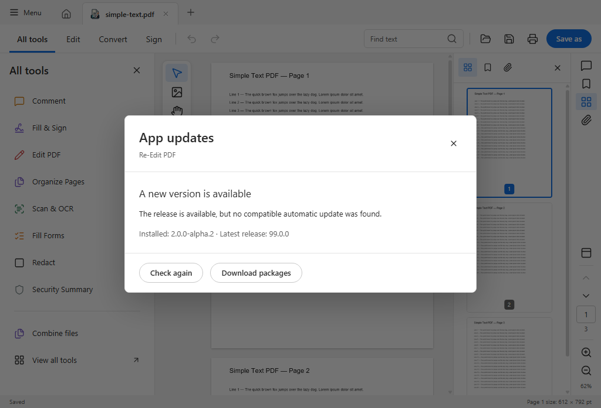
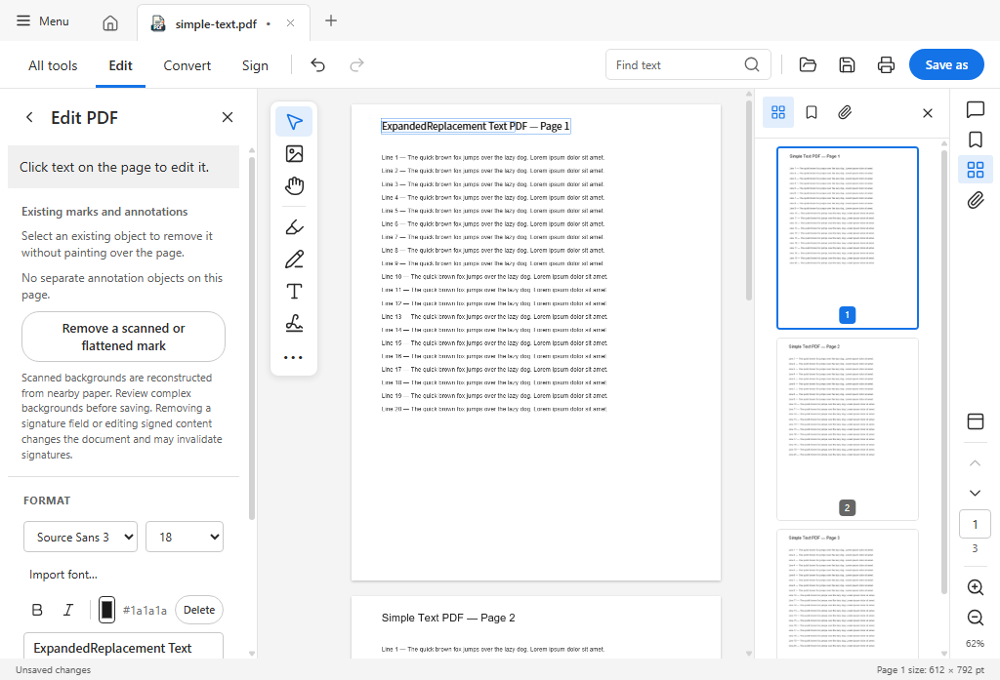
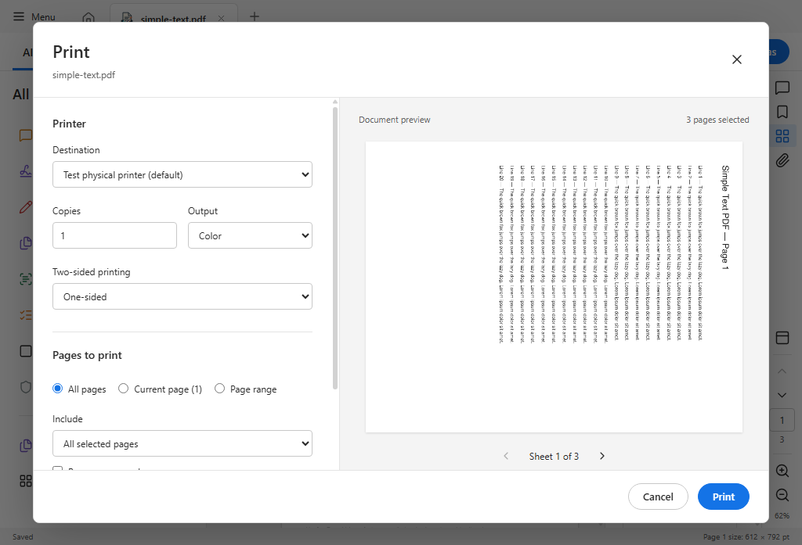

# v2.0.0-alpha.2 validation

This native preview retains the React workspace in Tauri with a Rust backend.
It does not claim full Acrobat compatibility. The stable Electron release stays
on its separate update channel.

## Scope

- Font fallback, connected-line text editing, repeated-edit cleanup, OCR faint
  text and sparse footer recognition, Convert menu styling, existing annotation
  and field removal, form undo, permissions and flattened-mark removal.
- Certificate Fit Width stability, mixed page sizes/crops/rotation and stable
  zoom during continuous scrolling.
- Startup update notifications, semantic prerelease comparisons, signature
  verification and rejection of tampered downloads. No test installs an update
  on the development machine.

## Passed checks

- Local frontend: 142 passed, one optional LibreOffice integration test skipped,
  across 28 files. The package jobs passed 139 tests plus that skip on Windows,
  and 140 tests including Office conversion on Linux. Three later local tests
  cover update-feed publication metadata; the live publication workflow also passed.
- Native Rust: six desktop tests and 21 core tests passed on both platforms.
- Windows WebView2: 76 checks passed across font/dialog, OCR editing, editing
  regression, OCR recognition, fit stability, updates, interaction and lifecycle
  suites. These include trusted double/triple clicks, ten-line drag selection,
  wheel zoom in/out and over the header, native viewport-scale translation,
  print preview orientation/scaling, simulated printer reconnection/fallback,
  repeated editing, save/reopen, and rejection of tampered update downloads.
- Windows setup EXE: assisted installation, Finish-to-launch, window display,
  normal close and uninstall passed. Finish dismissed in 0.117 seconds.
  MSI installation/runtime/close/uninstall checks also passed; only the setup
  EXE is published to keep the download list focused.
- Linux Ubuntu 22.04 WebKitGTK: 30 checks passed across desktop, editing, OCR,
  fit stability and update suites, including button text bounds.
- Debian 12, Ubuntu 24.04 and Fedora 43: package installation/dependencies,
  installed production app launch, AppImage extraction-mode launch and nine
  WebView checks per distribution passed in containers/Xvfb.
- All five package/source payloads have version-bound signatures verified with
  the app's updater identity. The manifest's signatures and hashes match those
  payloads. The public manifest also carries manual DEB/RPM/source signatures.

Raw results are in [TEST-REPORTS.json](TEST-REPORTS.json); artifact hashes, exact
build commits and workflow runs are in [BUILD-PROVENANCE.json](BUILD-PROVENANCE.json).
The platform builds contain the same application fixes; subsequent differences
are test synchronization and update-feed publication/documentation changes.
See [implementation notes](../../EDITOR-FIXES-2026-10-17.md) for targeted coverage.

## Resource cleanup

The Windows lifecycle suite completed 12 open/close cycles. Its JS heap samples
were approximately 11.7–12.7 MiB and ended at 12.5 MiB. Total private memory for
the app and WebView descendants after startup ranged from 208.6–225.7 MiB and
ended at 218.0 MiB. Repeated edit/cancel cycles also kept preview-font counts
bounded, and print-session cleanup passed. These short scenarios did not show
sustained growth; they do not establish that every document or driver is leak-free.

## UI evidence

The update screenshot uses a synthetic version 99.0.0 to test the notification;
no update installer is executed. Printer availability is simulated in the input
suite; the print preview itself uses the app's native layout/render path.

## Limits

Physical printers, physical trackpads, stock Linux desktop/Wayland sessions,
complex multilingual layouts and broad large-document workloads still need
real-device coverage. Container/Xvfb results are not stock desktop validation.
Synthetic touchscreen pinch generation did not produce viewport events in this
desktop test host; trusted trackpad-style wheel delivery and native scale-change
translation were tested separately. No physical trackpad or printer claim is made.
The scanned-mark eraser estimates paper pixels; it cannot recover pixels hidden
by an original mark. Review the result. Paragraph reflow, advanced shaping and
exact reconstruction on complex backgrounds remain limited.

Windows publisher signing is not configured. Updater signatures use the existing
project identity and protect package authenticity independently of Windows trust.
Linux automatic installation is intended for AppImage; install DEB/RPM updates
with the matching package manager.
Signed download verification and installer lifecycle were tested separately;
an in-place upgrade from a user's existing installation was not exercised.
